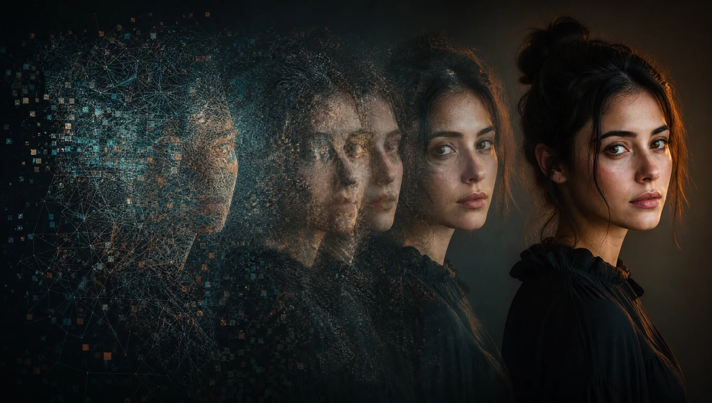

<p align="center">
  
</p>

<h1 align="center">GenPhoto</h1>

<p align="center">
  <b>Studio generowania zdjęć AI — frontend dla Stable Diffusion Forge, ComfyUI i Krea.</b><br>
  Czysty Python, biblioteka standardowa, zero frameworków. Jeden plik, jeden proces.
</p>

<p align="center">
  
  
  
  
</p>

---

## Czym jest GenPhoto

GenPhoto to jednoplikowy serwer WWW (`http.server` ze standardowej biblioteki Pythona), który
zamienia lokalny [Stable Diffusion Forge](https://github.com/lllyasviel/stable-diffusion-webui-forge)
w wygodne studio do generowania i obróbki zdjęć. Cała logika — routing, kolejka zadań, baza historii,
integracje z modelami LLM — mieści się w jednym pliku `genphoto.py`, bez Flaska, FastAPI ani żadnego
frameworka. Interfejs to statyczny HTML renderowany po stronie serwera.

Powstał jako narzędzie jednoosobowe: prosty w uruchomieniu (`python3 genphoto.py`), lekki i w pełni
self-hosted. Klucze API i hasło czyta wyłącznie ze zmiennych środowiskowych — w kodzie nie ma żadnych
sekretów.

## Funkcje

**Generowanie**
- **txt2img** przez Forge — pełna kontrola nad promptem, seedem, samplerem, wymiarami
- **Batch po wszystkich modelach** — jeden prompt, porównanie wyników z każdego checkpointu naraz
- **img2img** z obrazem referencyjnym
- **Inpainting / edycja** fragmentu obrazu z historią kolejnych poprawek
- **Z-Image** przez ComfyUI (UNet z konfigurowalną kwantyzacją)
- **Wideo WAN** — generowanie krótkich klipów
- **Krea** — osobny backend z wariantami batch

**Twarze i postać**
- **Wykrywanie i auto-kadrowanie twarzy** (InsightFace)
- **InstantID** — portret zachowujący tożsamość z jednego zdjęcia
- **Pose / ControlNet** — generowanie wg zadanej pozy

**Wsparcie AI**
- **Generator promptów** — opisujesz scenę po polsku, model LLM ([DeepSeek](https://platform.deepseek.com)
  lub [OpenRouter](https://openrouter.ai)) zwraca gotowy prompt SD z tagami i wagami
- **Vision → prompt** — wgrywasz obraz, model wizyjny (Qwen-VL przez OpenRouter albo lokalna Ollama)
  opisuje go i zamienia w prompt

**Zarządzanie zasobami**
- **LoRA** — lista, upload, pobieranie prosto z [Civitai](https://civitai.com)
- **Modele** — pobieranie z Civitai w tle, zapamiętane ustawienia per model, auto-konfiguracja z linku
- **VRAM** — podgląd zużycia i zwalnianie pamięci karty
- **Historia** — każda generacja zapisana w SQLite, z metadanymi i podglądem
- **Publikacja** — wysłanie wybranych zdjęć do zewnętrznej galerii / portalu

## Jak to działa

```
                       ┌──────────────────────────────┐
   przeglądarka  ◄───► │  genphoto.py                 │
   (statyczny HTML)    │  http.server + kolejka zadań │
                       └──────────────┬───────────────┘
                                      │
            ┌─────────────┬───────────┼───────────┬─────────────┐
            ▼             ▼           ▼           ▼             ▼
         Forge        ComfyUI       Krea      DeepSeek /     Ollama
       (txt2img,    (Z-Image,    (warianty)  OpenRouter    (lokalny
        img2img,      wideo)                  (prompty,      vision)
        InstantID,                             vision)
        pose, edit)
```

Renderer nigdy nie odwołuje się do usług AI bezpośrednio — każde żądanie przechodzi przez serwer
`genphoto.py`, który dokłada uwierzytelnienie i trzyma klucze wyłącznie po swojej stronie. Sesje
chronione są ciasteczkiem, a tokeny mają TTL (nie żyją w nieskończoność do restartu procesu).

## Wymagania

- **Python 3.10+** (tylko biblioteka standardowa — nic do `pip install` po stronie GenPhoto)
- Działający **Stable Diffusion Forge** (domyślnie `http://localhost:7860`)
- Opcjonalnie: **ComfyUI** (Z-Image, wideo), **Krea**, **Ollama** (lokalny vision)
- Opcjonalnie: klucz **DeepSeek** lub **OpenRouter** do generatora promptów i opisu obrazów
- Do wykrywania twarzy: **InsightFace** (jedyna zewnętrzna zależność, jeśli używasz funkcji twarzy)

## Konfiguracja

Wszystko ustawiasz zmiennymi środowiskowymi z prefiksem `GP_`. Skopiuj `.env.example` do `.env`
i uzupełnij. **W repozytorium nie ma żadnych kluczy** — puste domyślne wartości oznaczają, że
dana integracja jest wyłączona, dopóki nie podasz klucza.

| Zmienna | Opis | Domyślnie |
|---|---|---|
| `GP_PORT` | Port serwera | `7862` |
| `GP_USERNAME` | Login do panelu | `admin` |
| `GP_PASSWORD_HASH` | Hasło jako hash SHA-256 (patrz niżej) | *(puste — wymagane)* |
| `GP_FORGE_URL` | Adres Stable Diffusion Forge | `http://localhost:7860` |
| `GP_COMFY_URL` | Adres ComfyUI (Z-Image, wideo) | `http://localhost:8189` |
| `GP_KREA2_URL` | Adres backendu Krea | `http://localhost:7870` |
| `GP_AI_PROVIDER` | Dostawca promptów: `deepseek` / `openrouter` | `deepseek` |
| `GP_DEEPSEEK_KEY` | Klucz API DeepSeek | *(puste)* |
| `GP_OR_KEY` | Klucz API OpenRouter | *(puste)* |
| `GP_LOCAL_VISION_URL` | Endpoint lokalnego modelu vision (Ollama) | *(puste)* |
| `GP_OUTPUTS_DIR` | Katalog z wynikami Forge | `/ścieżka/do/forge/outputs` |
| `GP_LORAS_DIR` | Katalog z LoRA | `/ścieżka/do/loras` |
| `GP_DB_PATH` | Plik bazy historii | `./genphoto.db` |
| `GP_GALLERY_URL` / `GP_PORTAL_URL` | Adresy zewnętrznej galerii / portalu do publikacji | *(opcjonalne)* |
| `GP_PORTAL_KEY` | Klucz do publikacji w portalu | *(puste)* |

Pełną listę (m.in. wybór modeli DeepSeek/OpenRouter, katalogi ComfyUI, kwantyzacja Z-Image)
znajdziesz w sekcji `Config` na początku `genphoto.py`.

### Hasło

Panel jest za logowaniem. Hasło przechowujesz jako hash SHA-256, nie jako tekst jawny:

```bash
python3 -c "import hashlib; print(hashlib.sha256('TWOJE_HASLO'.encode()).hexdigest())"
```

Wynik wpisujesz do `GP_PASSWORD_HASH`.

## Uruchomienie

```bash
# 1. skonfiguruj
cp .env.example .env
# uzupełnij .env — minimum: GP_PASSWORD_HASH i adres Forge

# 2. odpal (wczytując zmienne z .env)
set -a; . ./.env; set +a
python3 genphoto.py
```

Domyślnie serwer nasłuchuje na `http://localhost:7862`. Dla dostępu zdalnego postaw go za
reverse-proxy lub tunelem — GenPhoto celowo nie zajmuje się terminacją TLS ani dostępem z zewnątrz.

## Bezpieczeństwo

- Sekrety (klucze, hash hasła) żyją **wyłącznie w zmiennych środowiskowych** — `.env` i pliki bazy
  są w `.gitignore` i nigdy nie trafiają do repozytorium.
- Dostęp do panelu chroni logowanie; porównanie loginu i hasła idzie przez `secrets.compare_digest`
  (odporne na timing attack), tokeny sesji mają ograniczony czas życia.
- Klucze API nie opuszczają procesu serwera — przeglądarka nigdy ich nie widzi.

## Stack

Czysty **Python 3** (biblioteka standardowa: `http.server`, `sqlite3`, `urllib`, `hashlib`, `secrets`),
statyczny **HTML/CSS/JS** bez frameworka, **SQLite** na historię. Integracje: Stable Diffusion Forge,
ComfyUI, Krea, DeepSeek, OpenRouter, Ollama, InsightFace, Civitai.

---

<p align="center">
  <sub>GenPhoto — narzędzie self-hosted. Autor: <a href="https://ebartnet.pl">Bartłomiej Kleparski</a>.</sub>
</p>
